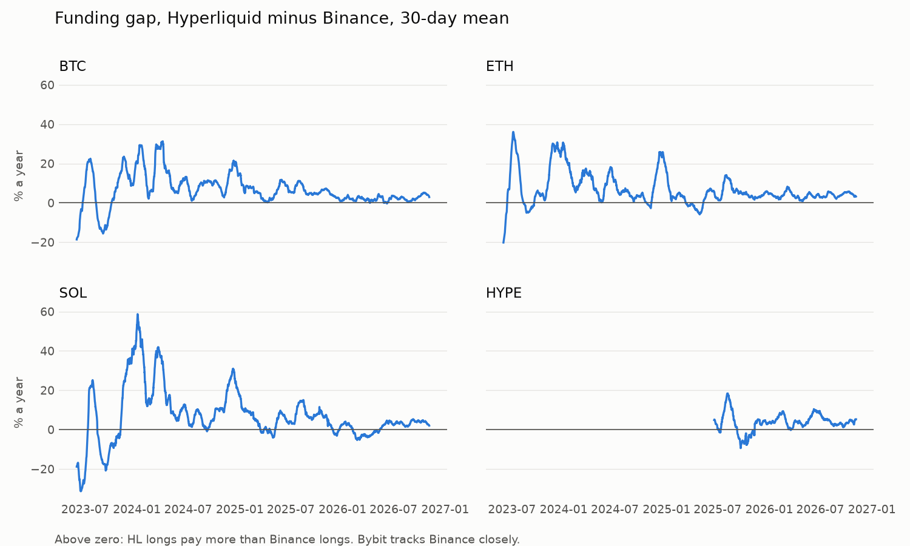

# Hyperliquid vs Binance/Bybit funding

How far apart is perp funding on Hyperliquid from Binance and Bybit for BTC, ETH, SOL and HYPE, how long
does a gap last, and how much of it is left once you pay to hold both sides?

This is descriptive research. It does not place orders or recommend trades.

Write-up: [bykobuteyko.com/research/hyperliquid-funding](https://bykobuteyko.com/research/hyperliquid-funding/).
Related: [Hyperliquid whale positioning](https://bykobuteyko.com/research/hyperliquid-whales/), [how much of the bitcoin ETF bid is a basis trade](https://bykobuteyko.com/research/bitcoin-etf-basis/).

## Findings

Data runs from May 2023 to November 2026 (HYPE from May 2025 against Binance, December 2024 against Bybit). Gap means HL funding minus CEX funding,
annualised. The table compares against Binance; Bybit gives nearly the same numbers.



| | BTC | ETH | SOL | HYPE |
|---|---|---|---|---|
| Mean gap, whole span, % a year (95% interval) | 6.6 (4.7 to 9.4) | 6.7 (4.7 to 9.6) | 7.0 (3.7 to 11.6) | 3.9 (1.6 to 5.9) |
| Mean gap in 2024 | 12.2 | 9.1 | 14.5 | n/a |
| Mean gap in 2026 so far (95% interval) | 2.3 (1.5 to 3.0) | 3.8 (3.1 to 4.8) | 1.2 (-0.8 to 2.9) | 4.7 (3.1 to 6.2) |
| Half-life of a gap, hours | 17 | 15 | 19 | 5 |
| Hold the hedge throughout, 2x per leg, return on capital, % a year | 6.9 | 7.0 | 7.2 | 3.4 |
| Cross-venue collateral moves that needed | 7 | 20 | 33 | 11 |
| Trade only the spikes (enter above 40%, taker), % a year | 1.3 | 1.2 | 2.8 | -3.1 |

What I take from it:

1. **HL longs have paid more than CEX longs, and it is not the interest term.** All three venues add the same
   0.01% per 8h, so the ~11% a year that HL longs pay at rest is there on Binance and Bybit too and cancels
   in the gap. What is left is about 6.5% a year for BTC, ETH and SOL over the whole span. Intervals come from
   a block bootstrap on daily means with 30-day blocks, so they allow for the gap staying high or low for weeks.
2. **The gap is closing.** It peaked in late 2023 and 2024 and has sat at 1 to 5% a year through 2026. For SOL
   the 2026 interval includes zero.
3. **Spikes are short; the base level is slow.** Most large gaps halve within a day, so a rule that waits for a
   big settled gap and exits when it flips keeps only a small part of it after taker fees (20 to 25 bps per
   round trip). Simply holding the position earned more over the whole span, because the gap mostly stayed
   on one side.
4. **Holding is not free of work.** The two legs sit on different venues, so a rally drains the short leg's
   margin while the long leg's grows. In my hourly simulation 2x per leg needed between 7 (BTC) and 33 (SOL)
   collateral moves in 3.5 years. At 5x per leg, SOL and HYPE on Bybit get liquidated even on hourly closes,
   which hide the intra-hour wicks.
5. **At 2x per leg the return on capital is about the gap itself.** In 2026 that is 1 to 5% a year (BTC 2.3, ETH 3.8, SOL 1.2, HYPE 4.7), around
   what short US Treasury bills paid over the same months (3.6 to 3.8% in the readings I found). Most of
   the opportunity, if there was one, was in 2023 and 2024.
6. **The gap is wider in volatile weeks for BTC and SOL** (SOL: 8% a year in the calmest third of 8-hour blocks, 19% in
   the most volatile third), not for ETH. So part of the gap pays for holding the trade when margin risk is
   highest.
7. **HYPE behaves differently.** Against Binance the gap is smaller and fades within hours, and trading the
   spikes loses money after fees.

The price gap between HL and the CEXs on hourly closes is 2 to 6 bps, and it moves by a similar amount over a
week. That is small next to the fees.

## Method

- `fetch.py` pulls the full funding history from all three venues, hourly closes (~200 days
  on all venues, Binance back to May 2023) and an order book snapshot into `funding.db`. Rerunning it tops the data up.
- `analyze.py` turns each settlement into a per-hour rate spread over the hours it covers, takes
  HL minus CEX, and reports the distribution, persistence (autocorrelation and AR(1) half-life on 8h
  blocks), a simple enter/hold/exit rule net of fees and slippage, the gap by volatility regime, and the
  price gap between venues.
- `static.py` checks the hold-it-throughout case: bootstrap intervals for the mean gap overall and by year,
  the mean per quarter, and an hour-by-hour margin simulation of both legs at 2x, 3x and 5x with collateral
  moves and taker fees on each resize.
- `charts.py` draws the chart above.
- `DATA.md` has the endpoints, units, intervals and quirks I checked before using them.

```
python -m venv .venv
.venv/Scripts/pip install requests pandas numpy matplotlib
.venv/Scripts/python fetch.py
.venv/Scripts/python analyze.py
.venv/Scripts/python static.py
.venv/Scripts/python charts.py
```

## Limitations

- Fees are base tier. A large desk pays less, and maker rebates change the picture a lot.
- Slippage is the median over the few order book snapshots I have taken, not a history. HL's API shows 20
  levels per side; when that runs out I use its price-rounded book, which overstates the cost a little.
- The backtest assumes I hold through every settlement and earn the CEX payment spread over its window.
  CEXs actually pay whoever holds at the settlement instant.
- Basis (the price gap between venues) is only measured over the last ~200 days and is reported next to
  the carry, not inside it. On a short hold it can be larger than the funding earned.
- The margin simulation uses Binance hourly closes for both legs. Real liquidations use each venue's mark
  price, which can wick inside the hour. It counts collateral moves but charges nothing for them and
  assumes they arrive in time.
- HL margin is USDC and Binance/Bybit margin here is USDT. I ignore the conversion and any yield the
  collateral could earn elsewhere.
- Hyperliquid launched hourly funding in June 2023 and HYPE only listed in late 2024, so samples differ
  per coin.

## License

MIT. See [LICENSE](LICENSE).
